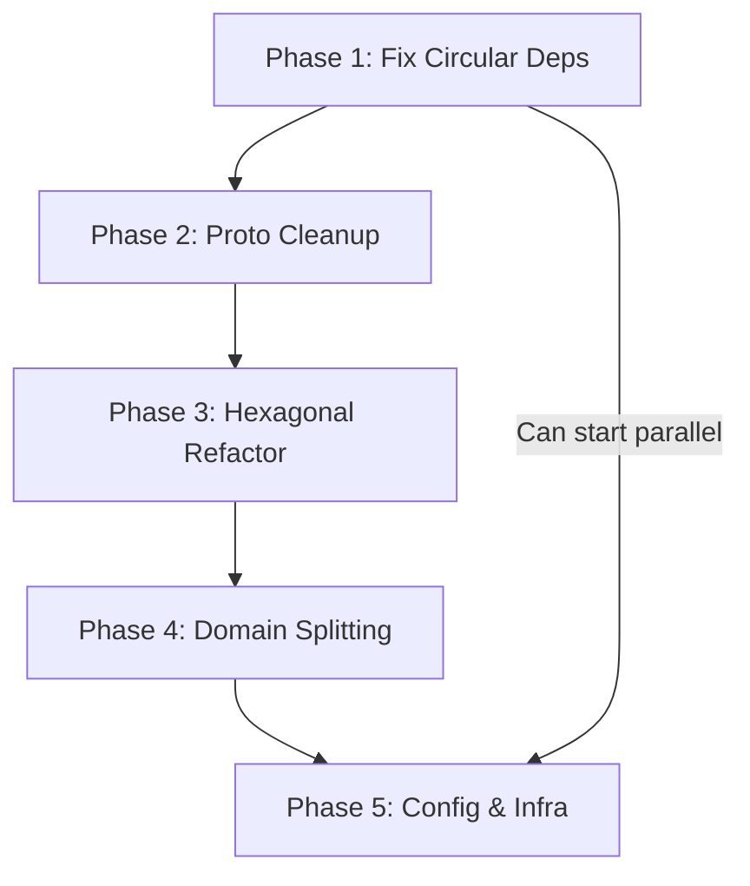

# FitME-gRPC Project Structure Improvements

A comprehensive implementation plan for refactoring the FitME-gRPC codebase to follow hexagonal architecture patterns, improve maintainability, and resolve structural issues.

---

## Executive Summary

This document outlines a phased approach to refactoring the FitME-gRPC project from its current structure to a clean, hexagonal architecture. The improvements address:

1. **Circular dependency** between `fitme-grpc` and `fitme-protos`
2. **Massive file sizes** in the meals domain (~120KB combined)
3. **Business logic leaking** into the proto module
4. **Lack of clear domain boundaries** between layers
5. **Configuration sprawl** (91+ config files)

---

## Table of Contents

- [Current Architecture Analysis](#current-architecture-analysis)
- [Target Architecture](#target-architecture)
- [Phase 1: Fix Circular Dependencies](#phase-1-fix-circular-dependencies)
- [Phase 2: Proto Module Cleanup](#phase-2-proto-module-cleanup)
- [Phase 3: Hexagonal Refactor](#phase-3-hexagonal-refactor)
- [Phase 4: Domain Splitting](#phase-4-domain-splitting)
- [Phase 5: Configuration & Infrastructure](#phase-5-configuration--infrastructure)
- [Migration Strategy](#migration-strategy)
- [Risk Assessment](#risk-assessment)

---

## Current Architecture Analysis

### Project Structure Overview

```
fitme-grpc/
├── main.go                           # Entry point (4KB)
├── config/                           # 91 configuration files
├── internal/
│   ├── domain/
│   │   ├── repository.go             # 10KB - All repository interfaces
│   │   ├── service.go                # 1.6KB - Service definitions
│   │   ├── auth/                     # 5 files
│   │   ├── calculator/               # 4 files  
│   │   ├── meals/                    # 4 files, 130KB total ⚠️
│   │   ├── measurements/             # 3 files
│   │   ├── activity/                 # 3 files
│   │   └── workout/                  # 3 files
│   ├── container.go                  # DI container
│   ├── server.go                     # gRPC server setup
│   ├── db.go                         # Database configuration
│   └── migrations/                   # 17 SQL files
├── protocol/grpc/                    # gRPC infrastructure
└── logger/
```

```
fitme-protos/
├── proto/                            # 13 .proto files
├── modules/                          # Generated + implementations ⚠️
│   ├── */generated/                  # protoc output
│   └── */implemented.go              # gRPC client wrappers ⚠️
├── container/                        # Broker container ⚠️
├── core/                             # Broker interface ⚠️
└── utils/                            # Transport utilities ⚠️
```

### Critical Issues Identified

| Issue | Severity | Location | Impact |
|-------|----------|----------|--------|
| Circular dependency | 🔴 Critical | go.mod (both modules) | Build failures, versioning issues |
| 80KB repository file | 🟠 High | meals/repository.go | Unmaintainable, merge conflicts |
| 40KB service file | 🟠 High | meals/service.go | Same as above |
| Runtime code in proto module | 🟠 High | fitme-protos/container/ | Architecture violation |
| Inconsistent proto packages | 🟡 Medium | proto/*.proto | Client confusion |
| Config file explosion | 🟡 Medium | config/ (91 files) | Deployment complexity |
| No domain entity separation | 🟡 Medium | domain/*/ | Proto coupling |

---

## Target Architecture

### Hexagonal Architecture Overview

```
┌─────────────────────────────────────────────────────────────────┐
│                        PRIMARY ADAPTERS                         │
│  ┌─────────────┐  ┌─────────────┐  ┌─────────────────────────┐ │
│  │   gRPC      │  │    HTTP     │  │       CLI/Tests         │ │
│  │  Handlers   │  │  Handlers   │  │                         │ │
│  └──────┬──────┘  └──────┬──────┘  └────────────┬────────────┘ │
└─────────┼────────────────┼──────────────────────┼───────────────┘
          │                │                      │
          ▼                ▼                      ▼
┌─────────────────────────────────────────────────────────────────┐
│                      INPUT PORTS (Use Cases)                    │
│  ┌─────────────────────────────────────────────────────────────┐│
│  │ AuthService │ MealService │ WorkoutService │ ActivityService││
│  └─────────────────────────────────────────────────────────────┘│
└─────────────────────────────────────────────────────────────────┘
                              │
                              ▼
┌─────────────────────────────────────────────────────────────────┐
│                         DOMAIN CORE                             │
│  ┌──────────┐  ┌──────────┐  ┌──────────┐  ┌──────────────────┐│
│  │  Auth    │  │   Meal   │  │ Workout  │  │    Activity      ││
│  │ Entities │  │ Entities │  │ Entities │  │    Entities      ││
│  └──────────┘  └──────────┘  └──────────┘  └──────────────────┘│
│                    Business Rules & Validation                  │
└─────────────────────────────────────────────────────────────────┘
                              │
                              ▼
┌─────────────────────────────────────────────────────────────────┐
│                     OUTPUT PORTS (Repositories)                 │
│  ┌─────────────────────────────────────────────────────────────┐│
│  │ AuthRepo  │  MealRepo  │  WorkoutRepo  │  ActivityRepo     ││
│  └─────────────────────────────────────────────────────────────┘│
└─────────────────────────────────────────────────────────────────┘
          │                │                      │
          ▼                ▼                      ▼
┌─────────────────────────────────────────────────────────────────┐
│                      SECONDARY ADAPTERS                         │
│  ┌─────────────┐  ┌─────────────┐  ┌─────────────────────────┐ │
│  │  PostgreSQL │  │    Redis    │  │   External Services     │ │
│  │   Repos     │  │    Cache    │  │   (Kafka, S3, etc.)     │ │
│  └─────────────┘  └─────────────┘  └─────────────────────────┘ │
└─────────────────────────────────────────────────────────────────┘
```

### Target Directory Structure

```
fitme-grpc/
├── cmd/
│   └── server/
│       └── main.go                    # Clean entry point
│
├── config/
│   ├── config.go                      # Config loader
│   ├── config.yaml                    # Main config
│   └── config.local.yaml              # Local overrides
│
├── internal/
│   ├── adapter/                       # All adapters (ports implementation)
│   │   ├── primary/                   # Driving adapters
│   │   │   ├── grpc/
│   │   │   │   ├── handler/
│   │   │   │   │   ├── auth_handler.go
│   │   │   │   │   ├── meal_handler.go
│   │   │   │   │   ├── workout_handler.go
│   │   │   │   │   └── ...
│   │   │   │   ├── mapper/            # Proto <-> Domain converters
│   │   │   │   │   ├── auth_mapper.go
│   │   │   │   │   └── meal_mapper.go
│   │   │   │   └── server.go
│   │   │   └── http/
│   │   │       ├── health.go
│   │   │       └── metrics.go
│   │   │
│   │   └── secondary/                 # Driven adapters
│   │       ├── postgres/
│   │       │   ├── auth_repo.go
│   │       │   ├── meal/              # Split large domains
│   │       │   │   ├── meal_plan_repo.go
│   │       │   │   ├── food_log_repo.go
│   │       │   │   ├── ingredient_repo.go
│   │       │   │   ├── reminder_repo.go
│   │       │   │   └── common.go
│   │       │   ├── workout_repo.go
│   │       │   └── activity_repo.go
│   │       ├── redis/
│   │       │   ├── session_store.go
│   │       │   └── cache.go
│   │       └── external/
│   │           └── notification_client.go
│   │
│   ├── domain/                        # Pure business logic
│   │   ├── auth/
│   │   │   ├── entity.go              # User, Session, Token
│   │   │   ├── service.go             # AuthService implementation
│   │   │   ├── port.go                # Repository interfaces
│   │   │   └── errors.go              # Domain-specific errors
│   │   ├── meal/
│   │   │   ├── entity.go              # MealPlan, Meal, Ingredient
│   │   │   ├── meal_plan_service.go   # Split by subdomain
│   │   │   ├── food_log_service.go
│   │   │   ├── ingredient_service.go
│   │   │   ├── port.go
│   │   │   └── errors.go
│   │   ├── workout/
│   │   ├── activity/
│   │   ├── measurement/
│   │   └── calculator/
│   │
│   └── infrastructure/                # Cross-cutting concerns
│       ├── container/
│       │   └── container.go           # Dependency injection
│       ├── telemetry/
│       │   ├── tracing.go
│       │   └── metrics.go
│       ├── database/
│       │   ├── postgres.go
│       │   ├── redis.go
│       │   └── migrations/
│       └── middleware/
│           ├── auth.go
│           ├── logging.go
│           └── recovery.go
│
├── pkg/                               # Public packages
│   ├── logger/
│   │   └── logger.go
│   └── errors/
│       └── errors.go
│
├── deploy/
│   ├── docker/
│   │   └── Dockerfile
│   ├── k8s/
│   │   ├── deployment.yaml
│   │   └── service.yaml
│   └── docker-compose.yaml
│
├── docs/
│   ├── architecture.md
│   └── improvements.md               # This file
│
├── go.mod
├── go.sum
├── Makefile
└── README.md
```

---

## Phase 1: Fix Circular Dependencies

**Duration:** 1-2 days  
**Risk:** Low  
**Priority:** 🔴 Critical

### Problem

```go
// fitme-grpc/go.mod
require github.com/FACorreiaa/fitme-protos v0.0.0-20250218122301-58600ee7869e

// fitme-protos/go.mod - THIS IS THE PROBLEM
require github.com/FACorreiaa/fitme-grpc v0.0.0-20250218122918-329bec8d85ce
```

### Solution

Move all runtime code from `fitme-protos` to `fitme-grpc`:

#### Step 1.1: Identify Code to Move

| Source (fitme-protos) | Destination (fitme-grpc) |
|----------------------|--------------------------|
| `container/container.go` | `internal/infrastructure/broker/container.go` |
| `core/core.go` | `internal/infrastructure/broker/interface.go` |
| `utils/connection.go` | `internal/infrastructure/broker/connection.go` |
| `utils/transport.go` | `internal/infrastructure/broker/transport.go` |
| `modules/*/implemented.go` | `internal/infrastructure/broker/*/client.go` |

#### Step 1.2: Create Broker Package

```go
// internal/infrastructure/broker/interface.go
package broker

import "google.golang.org/grpc"

// Broker is the interface for all gRPC client connections
type Broker interface {
    NewConnection() (*grpc.ClientConn, error)
    GetAddress() string
}
```

```go
// internal/infrastructure/broker/container.go
package broker

import (
    activity "buf.build/gen/go/facorreiaa/fitme/protocolbuffers/go/fitme/v1"
    // ... other imports
)

type Brokers struct {
    Customer       customer.CustomerClient
    Auth           user.AuthClient
    Calculator     calculator.CalculatorClient
    Activity       activity.ActivityClient
    Workout        workout.WorkoutClient
    Measurements   measurement.UserMeasurementsClient
    Meals          meal.MealPlanClient
}
```

#### Step 1.3: Update Imports

Search and replace all imports:
```bash
# Find all files importing from fitme-protos container/utils
grep -r "github.com/FACorreiaa/fitme-protos/container" --include="*.go"
grep -r "github.com/FACorreiaa/fitme-protos/utils" --include="*.go"
```

#### Step 1.4: Remove Dependency from fitme-protos

```go
// fitme-protos/go.mod (AFTER)
module github.com/FACorreiaa/fitme-protos

go 1.24

require (
    google.golang.org/grpc v1.70.0
    google.golang.org/protobuf v1.36.5
)
// NO fitme-grpc dependency!
```

#### Step 1.5: Verification

```bash
cd ../fitme-protos && go mod tidy && go build ./...
cd ../fitme-grpc && go mod tidy && go build ./...
```

---

## Phase 2: Proto Module Cleanup

**Duration:** 2-3 days  
**Risk:** Medium  
**Priority:** 🟠 High

### Goals

1. Migrate to Buf Schema Registry (BSR)
2. Add API versioning
3. Standardize package naming

### Step 2.1: Set Up Buf

```yaml
# fitme-protos/buf.yaml
version: v2
name: buf.build/facorreiaa/fitme
modules:
  - path: proto
lint:
  use:
    - DEFAULT
breaking:
  use:
    - FILE
```

```yaml
# fitme-protos/buf.gen.yaml
version: v2
managed:
  enabled: true
  override:
    - file_option: go_package_prefix
      value: buf.build/gen/go/facorreiaa/fitme/protocolbuffers/go
plugins:
  - remote: buf.build/protocolbuffers/go
    out: gen/go
    opt: paths=source_relative
  - remote: buf.build/grpc/go
    out: gen/go
    opt: paths=source_relative
```

### Step 2.2: Restructure Proto Files

**Before:**
```
proto/
├── user.proto      # package fitSphere.auth
├── meal.proto      # package ? (inconsistent)
└── ...
```

**After:**
```
proto/
└── fitme/
    └── v1/
        ├── auth.proto        # package fitme.v1
        ├── meal.proto        # package fitme.v1
        ├── workout.proto     # package fitme.v1
        └── common.proto      # Shared messages
```

### Step 2.3: Update Proto Package Names

```protobuf
// proto/fitme/v1/auth.proto
syntax = "proto3";

package fitme.v1;

option go_package = "buf.build/gen/go/facorreiaa/fitme/protocolbuffers/go/fitme/v1;fitmev1";

import "fitme/v1/common.proto";

service AuthService {
  rpc Register(RegisterRequest) returns (RegisterResponse);
  rpc Login(LoginRequest) returns (LoginResponse);
  // ...
}
```

### Step 2.4: Create Common Proto

```protobuf
// proto/fitme/v1/common.proto
syntax = "proto3";

package fitme.v1;

import "google/protobuf/timestamp.proto";

message PaginationRequest {
  int32 page_size = 1;
  string page_token = 2;
}

message PaginationResponse {
  string next_page_token = 1;
  int32 total_count = 2;
}

message BaseRequest {
  string request_id = 1;
}

message BaseResponse {
  string request_id = 1;
  string status = 2;
}
```

### Step 2.5: Publish to BSR

```bash
# Login to BSR
buf registry login

# Push module
buf push

# Generate locally for testing
buf generate
```

### Step 2.6: Update fitme-grpc Imports

```go
// Before
import pb "github.com/FACorreiaa/fitme-protos/modules/user/generated"

// After
import pb "buf.build/gen/go/facorreiaa/fitme/protocolbuffers/go/fitme/v1"
```

---

## Phase 3: Hexagonal Refactor

**Duration:** 1-2 weeks  
**Risk:** Medium-High  
**Priority:** 🟠 High

### Step 3.1: Create Domain Entities

Separate proto types from domain entities:

```go
// internal/domain/auth/entity.go
package auth

import (
    "time"
    "github.com/google/uuid"
)

type User struct {
    ID           uuid.UUID
    Email        string
    Username     string
    PasswordHash string
    Role         Role
    IsAdmin      bool
    CreatedAt    time.Time
    UpdatedAt    time.Time
}

type Role string

const (
    RoleUnspecified Role = ""
    RoleAdmin       Role = "admin"
    RoleModerator   Role = "moderator"
    RoleCoach       Role = "coach"
    RoleUser        Role = "user"
)

type Session struct {
    ID        uuid.UUID
    UserID    uuid.UUID
    Token     string
    ExpiresAt time.Time
    CreatedAt time.Time
}
```

### Step 3.2: Define Port Interfaces

```go
// internal/domain/auth/port.go
package auth

import (
    "context"
    "github.com/google/uuid"
)

// Repository is the output port for auth persistence
type Repository interface {
    CreateUser(ctx context.Context, user *User) error
    GetUserByID(ctx context.Context, id uuid.UUID) (*User, error)
    GetUserByEmail(ctx context.Context, email string) (*User, error)
    GetUserByUsername(ctx context.Context, username string) (*User, error)
    UpdateUser(ctx context.Context, user *User) error
    DeleteUser(ctx context.Context, id uuid.UUID) error
    ListUsers(ctx context.Context, offset, limit int) ([]*User, error)
}

// SessionStore is the output port for session management
type SessionStore interface {
    CreateSession(ctx context.Context, session *Session) error
    GetSession(ctx context.Context, token string) (*Session, error)
    DeleteSession(ctx context.Context, token string) error
    DeleteUserSessions(ctx context.Context, userID uuid.UUID) error
}

// Service is the input port for auth use cases
type Service interface {
    Register(ctx context.Context, req RegisterRequest) (*User, error)
    Login(ctx context.Context, req LoginRequest) (*LoginResponse, error)
    Logout(ctx context.Context, token string) error
    ChangePassword(ctx context.Context, req ChangePasswordRequest) error
    RefreshToken(ctx context.Context, refreshToken string) (*TokenPair, error)
}
```

### Step 3.3: Create Service Implementation

```go
// internal/domain/auth/service.go
package auth

import (
    "context"
    "fmt"
    "time"

    "github.com/google/uuid"
    "golang.org/x/crypto/bcrypt"
)

type service struct {
    repo         Repository
    sessionStore SessionStore
    tokenTTL     time.Duration
}

func NewService(repo Repository, sessionStore SessionStore, tokenTTL time.Duration) Service {
    return &service{
        repo:         repo,
        sessionStore: sessionStore,
        tokenTTL:     tokenTTL,
    }
}

func (s *service) Register(ctx context.Context, req RegisterRequest) (*User, error) {
    // Check if user exists
    existing, _ := s.repo.GetUserByEmail(ctx, req.Email)
    if existing != nil {
        return nil, ErrUserAlreadyExists
    }

    // Hash password
    hash, err := bcrypt.GenerateFromPassword([]byte(req.Password), bcrypt.DefaultCost)
    if err != nil {
        return nil, fmt.Errorf("failed to hash password: %w", err)
    }

    user := &User{
        ID:           uuid.New(),
        Email:        req.Email,
        Username:     req.Username,
        PasswordHash: string(hash),
        Role:         RoleUser,
        CreatedAt:    time.Now(),
        UpdatedAt:    time.Now(),
    }

    if err := s.repo.CreateUser(ctx, user); err != nil {
        return nil, fmt.Errorf("failed to create user: %w", err)
    }

    return user, nil
}

// ... other methods
```

### Step 3.4: Create gRPC Handler (Primary Adapter)

```go
// internal/adapter/primary/grpc/handler/auth_handler.go
package handler

import (
    "context"

    pb "buf.build/gen/go/facorreiaa/fitme/protocolbuffers/go/fitme/v1"
    "github.com/FACorreiaa/fitme-grpc/internal/adapter/primary/grpc/mapper"
    "github.com/FACorreiaa/fitme-grpc/internal/domain/auth"
)

type AuthHandler struct {
    pb.UnimplementedAuthServiceServer
    service auth.Service
}

func NewAuthHandler(service auth.Service) *AuthHandler {
    return &AuthHandler{service: service}
}

func (h *AuthHandler) Register(ctx context.Context, req *pb.RegisterRequest) (*pb.RegisterResponse, error) {
    domainReq := mapper.ToRegisterRequest(req)
    
    user, err := h.service.Register(ctx, domainReq)
    if err != nil {
        return nil, mapper.ToGRPCError(err)
    }

    return &pb.RegisterResponse{
        Message: "User registered successfully",
        User:    mapper.ToUserProto(user),
    }, nil
}
```

### Step 3.5: Create Proto Mapper

```go
// internal/adapter/primary/grpc/mapper/auth_mapper.go
package mapper

import (
    pb "buf.build/gen/go/facorreiaa/fitme/protocolbuffers/go/fitme/v1"
    "github.com/FACorreiaa/fitme-grpc/internal/domain/auth"
    "github.com/google/uuid"
    "google.golang.org/protobuf/types/known/timestamppb"
)

func ToRegisterRequest(req *pb.RegisterRequest) auth.RegisterRequest {
    return auth.RegisterRequest{
        Email:    req.Email,
        Username: req.Username,
        Password: req.Password,
    }
}

func ToUserProto(user *auth.User) *pb.User {
    return &pb.User{
        Id:        user.ID.String(),
        Email:     user.Email,
        Username:  user.Username,
        Role:      toRoleProto(user.Role),
        IsAdmin:   user.IsAdmin,
        CreatedAt: timestamppb.New(user.CreatedAt),
        UpdatedAt: timestamppb.New(user.UpdatedAt),
    }
}

func FromUserProto(user *pb.User) *auth.User {
    id, _ := uuid.Parse(user.Id)
    return &auth.User{
        ID:        id,
        Email:     user.Email,
        Username:  user.Username,
        Role:      fromRoleProto(user.Role),
        IsAdmin:   user.IsAdmin,
        CreatedAt: user.CreatedAt.AsTime(),
        UpdatedAt: user.UpdatedAt.AsTime(),
    }
}
```

### Step 3.6: Create PostgreSQL Repository (Secondary Adapter)

```go
// internal/adapter/secondary/postgres/auth_repo.go
package postgres

import (
    "context"
    "fmt"

    "github.com/FACorreiaa/fitme-grpc/internal/domain/auth"
    "github.com/google/uuid"
    "github.com/jackc/pgx/v5/pgxpool"
)

type AuthRepository struct {
    pool *pgxpool.Pool
}

func NewAuthRepository(pool *pgxpool.Pool) *AuthRepository {
    return &AuthRepository{pool: pool}
}

func (r *AuthRepository) CreateUser(ctx context.Context, user *auth.User) error {
    query := `
        INSERT INTO users (id, email, username, password_hash, role, is_admin, created_at, updated_at)
        VALUES ($1, $2, $3, $4, $5, $6, $7, $8)
    `
    _, err := r.pool.Exec(ctx, query,
        user.ID, user.Email, user.Username, user.PasswordHash,
        user.Role, user.IsAdmin, user.CreatedAt, user.UpdatedAt,
    )
    if err != nil {
        return fmt.Errorf("failed to insert user: %w", err)
    }
    return nil
}

func (r *AuthRepository) GetUserByID(ctx context.Context, id uuid.UUID) (*auth.User, error) {
    query := `
        SELECT id, email, username, password_hash, role, is_admin, created_at, updated_at
        FROM users WHERE id = $1
    `
    user := &auth.User{}
    err := r.pool.QueryRow(ctx, query, id).Scan(
        &user.ID, &user.Email, &user.Username, &user.PasswordHash,
        &user.Role, &user.IsAdmin, &user.CreatedAt, &user.UpdatedAt,
    )
    if err != nil {
        return nil, fmt.Errorf("failed to get user: %w", err)
    }
    return user, nil
}

// ... other methods
```

---

## Phase 4: Domain Splitting

**Duration:** 1 week  
**Risk:** Medium  
**Priority:** 🟠 High

### Problem: Massive Meals Domain

Current state:
- `meals/repository.go` - **80KB** (~2000+ lines)
- `meals/service.go` - **40KB** (~1000+ lines)

### Solution: Split by Subdomain

```
internal/
├── domain/
│   └── meal/
│       ├── entity.go              # All meal entities
│       ├── port.go                # All port interfaces
│       ├── errors.go              # Domain errors
│       │
│       ├── mealplan/              # Meal Plan subdomain
│       │   └── service.go
│       │
│       ├── foodlog/               # Food Log subdomain
│       │   └── service.go
│       │
│       ├── ingredient/            # Ingredient subdomain
│       │   └── service.go
│       │
│       ├── reminder/              # Reminder subdomain
│       │   └── service.go
│       │
│       └── progress/              # Progress tracking subdomain
│           └── service.go
│
├── adapter/
│   └── secondary/
│       └── postgres/
│           └── meal/
│               ├── meal_plan_repo.go     # ~200 lines
│               ├── food_log_repo.go      # ~200 lines
│               ├── ingredient_repo.go    # ~200 lines
│               ├── reminder_repo.go      # ~150 lines
│               ├── progress_repo.go      # ~150 lines
│               └── common.go             # Shared SQL helpers
```

### Step 4.1: Define Entities

```go
// internal/domain/meal/entity.go
package meal

import (
    "time"
    "github.com/google/uuid"
)

type MealPlan struct {
    ID          uuid.UUID
    UserID      uuid.UUID
    Name        string
    Description string
    StartDate   time.Time
    EndDate     time.Time
    IsActive    bool
    Meals       []Meal
    CreatedAt   time.Time
    UpdatedAt   time.Time
}

type Meal struct {
    ID          uuid.UUID
    MealPlanID  uuid.UUID
    Name        string
    MealType    MealType
    ScheduledAt time.Time
    Ingredients []MealIngredient
    Calories    int
    CreatedAt   time.Time
}

type MealType string

const (
    MealTypeBreakfast MealType = "breakfast"
    MealTypeLunch     MealType = "lunch"
    MealTypeDinner    MealType = "dinner"
    MealTypeSnack     MealType = "snack"
)

type Ingredient struct {
    ID            uuid.UUID
    Name          string
    Category      string
    CaloriesPer100g float64
    Protein       float64
    Carbs         float64
    Fat           float64
}

type MealIngredient struct {
    IngredientID uuid.UUID
    Ingredient   *Ingredient
    Quantity     float64
    Unit         string
}

type FoodLog struct {
    ID          uuid.UUID
    UserID      uuid.UUID
    MealID      *uuid.UUID
    LoggedAt    time.Time
    Calories    int
    Notes       string
}

type Reminder struct {
    ID         uuid.UUID
    UserID     uuid.UUID
    MealType   MealType
    Time       time.Time
    IsEnabled  bool
    DaysOfWeek []int
}
```

### Step 4.2: Split Port Interfaces

```go
// internal/domain/meal/port.go
package meal

import (
    "context"
    "github.com/google/uuid"
)

// MealPlanRepository handles meal plan persistence
type MealPlanRepository interface {
    Create(ctx context.Context, plan *MealPlan) error
    GetByID(ctx context.Context, id uuid.UUID) (*MealPlan, error)
    GetByUser(ctx context.Context, userID uuid.UUID) ([]*MealPlan, error)
    Update(ctx context.Context, plan *MealPlan) error
    Delete(ctx context.Context, id uuid.UUID) error
    SetActive(ctx context.Context, userID, planID uuid.UUID) error
}

// MealRepository handles individual meals
type MealRepository interface {
    Create(ctx context.Context, meal *Meal) error
    GetByID(ctx context.Context, id uuid.UUID) (*Meal, error)
    GetByPlan(ctx context.Context, planID uuid.UUID) ([]*Meal, error)
    Update(ctx context.Context, meal *Meal) error
    Delete(ctx context.Context, id uuid.UUID) error
    AddIngredient(ctx context.Context, mealID uuid.UUID, ingredient MealIngredient) error
    RemoveIngredient(ctx context.Context, mealID, ingredientID uuid.UUID) error
}

// IngredientRepository handles ingredient catalog
type IngredientRepository interface {
    Create(ctx context.Context, ingredient *Ingredient) error
    GetByID(ctx context.Context, id uuid.UUID) (*Ingredient, error)
    Search(ctx context.Context, query string, limit int) ([]*Ingredient, error)
    ListByCategory(ctx context.Context, category string) ([]*Ingredient, error)
}

// FoodLogRepository handles food logging
type FoodLogRepository interface {
    Create(ctx context.Context, log *FoodLog) error
    GetByUser(ctx context.Context, userID uuid.UUID, from, to time.Time) ([]*FoodLog, error)
    GetDailySummary(ctx context.Context, userID uuid.UUID, date time.Time) (*DailySummary, error)
}

// ReminderRepository handles meal reminders
type ReminderRepository interface {
    Create(ctx context.Context, reminder *Reminder) error
    GetByUser(ctx context.Context, userID uuid.UUID) ([]*Reminder, error)
    Update(ctx context.Context, reminder *Reminder) error
    Delete(ctx context.Context, id uuid.UUID) error
}
```

### Step 4.3: Create Subdomain Services

```go
// internal/domain/meal/mealplan/service.go
package mealplan

import (
    "context"
    "github.com/FACorreiaa/fitme-grpc/internal/domain/meal"
    "github.com/google/uuid"
)

type Service struct {
    planRepo meal.MealPlanRepository
    mealRepo meal.MealRepository
}

func NewService(planRepo meal.MealPlanRepository, mealRepo meal.MealRepository) *Service {
    return &Service{
        planRepo: planRepo,
        mealRepo: mealRepo,
    }
}

func (s *Service) CreatePlan(ctx context.Context, userID uuid.UUID, name, description string) (*meal.MealPlan, error) {
    plan := &meal.MealPlan{
        ID:          uuid.New(),
        UserID:      userID,
        Name:        name,
        Description: description,
        IsActive:    false,
    }
    
    if err := s.planRepo.Create(ctx, plan); err != nil {
        return nil, err
    }
    
    return plan, nil
}

func (s *Service) GetUserPlans(ctx context.Context, userID uuid.UUID) ([]*meal.MealPlan, error) {
    return s.planRepo.GetByUser(ctx, userID)
}

// ... other methods
```

---

## Phase 5: Configuration & Infrastructure

**Duration:** 2-3 days  
**Risk:** Low  
**Priority:** 🟡 Medium

### Step 5.1: Consolidate Configuration

Replace 91 config files with a single YAML:

```yaml
# config/config.yaml
server:
  grpc_port: ${GRPC_PORT:8000}
  http_port: ${HTTP_PORT:8001}
  shutdown_timeout: 30s

database:
  postgres:
    host: ${POSTGRES_HOST:localhost}
    port: ${POSTGRES_PORT:5432}
    user: ${POSTGRES_USER:postgres}
    password: ${POSTGRES_PASSWORD:postgres}
    database: ${POSTGRES_DB:fitme}
    max_connections: 25
    min_connections: 5
  
  redis:
    host: ${REDIS_HOST:localhost}
    port: ${REDIS_PORT:6379}
    password: ${REDIS_PASSWORD:}
    db: 0

auth:
  jwt_secret: ${JWT_SECRET}
  jwt_ttl: 15m
  refresh_ttl: 7d

telemetry:
  enabled: true
  otel_endpoint: ${OTEL_ENDPOINT:localhost:4317}
  service_name: fitme-grpc
  
logging:
  level: ${LOG_LEVEL:info}
  format: json
```

### Step 5.2: Create Config Loader

```go
// config/config.go
package config

import (
    "fmt"
    "time"

    "github.com/spf13/viper"
)

type Config struct {
    Server    ServerConfig    `mapstructure:"server"`
    Database  DatabaseConfig  `mapstructure:"database"`
    Auth      AuthConfig      `mapstructure:"auth"`
    Telemetry TelemetryConfig `mapstructure:"telemetry"`
    Logging   LoggingConfig   `mapstructure:"logging"`
}

type ServerConfig struct {
    GRPCPort        string        `mapstructure:"grpc_port"`
    HTTPPort        string        `mapstructure:"http_port"`
    ShutdownTimeout time.Duration `mapstructure:"shutdown_timeout"`
}

type DatabaseConfig struct {
    Postgres PostgresConfig `mapstructure:"postgres"`
    Redis    RedisConfig    `mapstructure:"redis"`
}

type PostgresConfig struct {
    Host           string `mapstructure:"host"`
    Port           int    `mapstructure:"port"`
    User           string `mapstructure:"user"`
    Password       string `mapstructure:"password"`
    Database       string `mapstructure:"database"`
    MaxConnections int    `mapstructure:"max_connections"`
    MinConnections int    `mapstructure:"min_connections"`
}

func (p PostgresConfig) DSN() string {
    return fmt.Sprintf(
        "postgres://%s:%s@%s:%d/%s?sslmode=disable",
        p.User, p.Password, p.Host, p.Port, p.Database,
    )
}

func Load() (*Config, error) {
    viper.SetConfigName("config")
    viper.SetConfigType("yaml")
    viper.AddConfigPath("./config")
    viper.AddConfigPath(".")

    viper.AutomaticEnv()

    if err := viper.ReadInConfig(); err != nil {
        return nil, fmt.Errorf("failed to read config: %w", err)
    }

    var cfg Config
    if err := viper.Unmarshal(&cfg); err != nil {
        return nil, fmt.Errorf("failed to unmarshal config: %w", err)
    }

    return &cfg, nil
}
```

### Step 5.3: Clean Up Old Files

```bash
# Remove redundant Dockerfiles
rm Dockerfile-old Dockerfile-old2

# Remove outdated compose files
rm docker-compose-old.yml

# Archive old config files
mkdir -p config/archive
mv config/*.json config/archive/ 2>/dev/null || true
```

### Step 5.4: Update Makefile

```makefile
# Makefile
.PHONY: all build run test lint proto clean

VERSION ?= $(shell git describe --tags --always --dirty)
LDFLAGS := -ldflags "-X main.version=$(VERSION)"

# Build
build:
	go build $(LDFLAGS) -o bin/fitme-grpc ./cmd/server

run:
	go run ./cmd/server

# Development
dev:
	air

# Docker
docker-build:
	docker build -t fitme-grpc:$(VERSION) .

docker-run: docker-build
	docker compose up -d

docker-down:
	docker compose down

# Testing
test:
	go test -race -cover ./...

test-integration:
	go test -race -tags=integration ./...

# Linting
lint:
	golangci-lint run --config .golangci.yml

# Proto (if using local generation)
proto:
	buf generate

proto-lint:
	buf lint

# Database
migrate-up:
	migrate -path internal/infrastructure/database/migrations -database "$(DATABASE_URL)" up

migrate-down:
	migrate -path internal/infrastructure/database/migrations -database "$(DATABASE_URL)" down

# Clean
clean:
	rm -rf bin/
	rm -rf .data/
```

---

## Migration Strategy

### Recommended Order



### Branch Strategy

```
main
├── feature/phase-1-fix-circular-deps
├── feature/phase-2-proto-cleanup
├── feature/phase-3-hexagonal-refactor
│   ├── feature/phase-3.1-auth-domain
│   ├── feature/phase-3.2-meal-domain
│   └── feature/phase-3.3-workout-domain
├── feature/phase-4-domain-splitting
└── feature/phase-5-config-cleanup
```

### Testing Strategy

1. **Before each phase:** Create comprehensive integration tests
2. **During refactor:** Maintain all existing tests passing
3. **After completion:** Add unit tests for new structure

---

## Risk Assessment

| Phase | Risk Level | Mitigation |
|-------|------------|------------|
| Phase 1 | Low | Simple code move, no logic changes |
| Phase 2 | Medium | Run proto linter, generate and compare output |
| Phase 3 | Medium-High | Incremental refactor, one domain at a time |
| Phase 4 | Medium | Comprehensive tests before splitting |
| Phase 5 | Low | Non-breaking config changes |

### Rollback Plan

Each phase should be:
1. Implemented in a feature branch
2. Fully tested before merge
3. Tagged after successful deployment

```bash
# If issues arise, rollback to previous tag
git checkout v0.x.x
```

---

## Timeline Estimate

| Phase | Duration | Dependencies |
|-------|----------|--------------|
| Phase 1 | 1-2 days | None |
| Phase 2 | 2-3 days | Phase 1 |
| Phase 3 | 1-2 weeks | Phase 2 |
| Phase 4 | 1 week | Phase 3 (partial) |
| Phase 5 | 2-3 days | None (parallel) |

**Total estimated time:** 3-4 weeks

---

## Next Steps

1. [ ] Review this plan with team
2. [ ] Create Phase 1 branch and implement
3. [ ] Set up Buf Schema Registry account
4. [ ] Define integration test baseline
5. [ ] Schedule refactoring sprints

---

*Document created: 2026-01-03*  
*Last updated: 2026-01-03*
